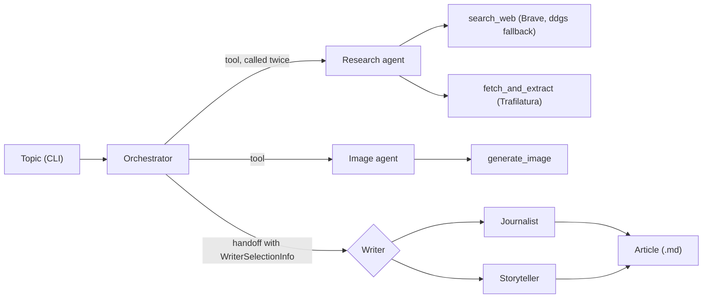

# Multi-Agent Article Writer

An orchestrator agent researches a topic, picks the right writer for it, and produces a sourced article with a generated hero image.

> Status: notebook prototype being packaged into a command line tool.

## The problem
TODO (Bruce): why a single prompt produces thin, poorly sourced articles, and why one writing style does not fit every topic.

## The solution
An orchestrator agent coordinates specialists instead of writing anything itself:
- A **research agent** searches the web (Brave, with DuckDuckGo as a fallback), reads at least 4 full pages of 2,000 or more characters each, and writes a cited brief.
- An **image agent** writes one image prompt and generates a hero image.
- A **journalist** (provocative, opinionated) or a **storyteller** (narrative, scene based) writes the article. The orchestrator picks one through a handoff that carries a typed `WriterSelectionInfo` (which writer, and why).
- LLM-judge evals score whether a research brief cites enough distinct sources.

## In action
TODO (Bruce): screenshots or a short GIF, plus the demo link. `assets/hero-example.jpg` is an example hero image from the scaffold.

## Architecture

### Requirements
**Functional**
- Take a topic as text and produce a Markdown article saved to a file.
- Research the topic from live web pages: read at least 4 distinct sources of at least 2,000 characters each, and cite only sources that were read.
- Generate one hero image and place it at the top of the article.
- Choose between two writing styles (journalist, storyteller) per topic and report which was used.
- Score a research brief for source breadth with an LLM judge over a fixed topic list.

**Non-functional**
- Fail loudly: a missing API key exits with code 1, and a run that ends without a writer producing the article exits with code 2 and writes no file.
- Tools return plain text messages the agent can act on (blocked site, page too short, already read) instead of raising.
- Searches are spaced and retried so parallel tool calls do not trigger rate limits.
- Secrets live in `.env` only. Models, limits, and paths can be overridden with `ARTICLE_WRITER_*` environment variables (see `src/article_writer/config.py`).
- The unit tests make no network or API calls.
- TODO (Bruce): measured latency and cost per article. Neither is recorded in this repo yet.

### API and interfaces
| Entry point | Input | Output |
|---|---|---|
| `article-writer "topic" [--out DIR] [--max-turns N] [--verbose]` | A topic string | `<out>/<slug>.md` (default `output/`). Prints the file path and the writer used. Exit 0 on success, 1 if `OPENAI_API_KEY` is missing, 2 if no writer produced the article. |
| `python -m article_writer.evals.run_evals` | None (uses the topics in `evals/topics.py`) | `output/evals/<timestamp>.csv` with topic, judge label, and brief. Prints label counts and the failure rate. |

Agent tools (what the agents call):
| Tool | Input | Output |
|---|---|---|
| `search_web` | `query` | JSON list of up to 10 results (`title`, `href`, `body`). Sites that blocked a fetch earlier are marked `fetchable: false`. |
| `fetch_and_extract` | `url` | Progress line plus the page text, or a message saying why the page does not count. |
| `generate_image` | `prompt` | The saved image path, or an error message. |
| `research_agent` | `input` (topic) | A Markdown brief with a numbered Sources list. |
| `image_generator_agent` | topic and summary | The image path. |

### High-level design


Each research call gets its own `ResearchState` (the set of sources it has read), passed to the tools as the SDK run context, so the two briefs are independent. The set of domains that refuse fetches is shared by the whole process on purpose.

### Evals
**What is measured.** Whether a research brief fails the "insufficient source breadth" test: fewer than 3 distinct, identifiable sources. A separate judge model (`gpt-5-mini`) reads only the brief and returns `TRUE` (failed) or `FALSE`. The prompt is in `evals/judge.py`.

**How.** `python -m article_writer.evals.run_evals` runs the research agent on the 10 topics in `evals/topics.py` (5 at a time on one event loop), judges each brief, writes `output/evals/<timestamp>.csv`, and prints the failure rate.

**Results** (one run, 2026-11-15, Brave search, `gpt-4.1-mini` research agent):

| Check | Result |
|---|---|
| Topics scored (no errors) | 10 of 10 |
| Judge label `FALSE` (sufficient breadth) / `TRUE` | 10 / 0 |
| Failure rate reported by the runner | 0% |
| Briefs with a Sources section listing 4 URLs (counted by hand from the CSV) | 7 of 10 |
| Briefs that ended with a progress note instead of a report (no Sources section, 139 to 350 words) | 3 of 10 |
| Judge sanity check by hand: a brief with one source, and an empty brief | both `TRUE` |

**Read the 0% with care.** The judge accepts a source that is only named, so it scored the 3 unfinished briefs `FALSE` because they list source names ("World Nuclear Association", "Desjardins Online Brokerage"). Those 3 are not research briefs, which means the research agent sometimes announces the next step and stops. The judge does not catch this.

**Source check (code).** The runner now also applies `source_problem` from `tools/fetch.py` to each brief: it must have a `## Sources` section that cites at least the required number of sources the agent actually read with `fetch_and_extract`. The result is in the `check_failure` column (`TRUE` means failed), with the feedback text in `check_detail`, and its own failure rate is printed next to the judge's. TODO (Bruce): rerun the evals and add the source check results to the table above.

An earlier run of the same command had 4 of 10 topics fail with `Event loop is closed`, because the runner used one event loop per thread. That is fixed, and the table above is from the fixed runner.

### Trade-offs and design decisions
| Decision | Alternatives considered | Why |
|---|---|---|
| Brave Search API first, DuckDuckGo (ddgs) as fallback | ddgs only; Brave's MCP server | Scraping engines through ddgs hit rate limits in this project (hence the throttle and backoff code). A REST call fits behind `search_web` without changing the prompt or the tool's output. An MCP server would expose different tool names and need a Node subprocess. |
| Per research call state (`ResearchState` in the run context) | A module level set of read URLs | A shared set made the second research call start with the first call's sources already counted, so the two briefs were not independent. |
| Domains that refuse fetches are cached at module level | Per run cache | A site that blocks one page blocks the rest, and the cache is cheap to share. |
| Two writer agents chosen by a typed handoff | One writer with a style parameter | Each style keeps its own rules in one prompt, and the handoff records which writer was chosen and why. |
| Tools are thin wrappers over plain helper functions | Logic inside the tool functions | The helpers can be unit tested without an agent or network (fetch decisions, search backoff, prompt rendering). |
| Prompts stored as Markdown files with `{PLACEHOLDERS}` | Prompts as Python strings | The prompt text can be read and diffed on its own. Limits like the required source count come from config. |
| The CLI exits with code 2 when the orchestrator ends without a handoff | Save whatever the final output is | In one smoke run the orchestrator ended its turn with a sentence and no handoff, which would otherwise be saved as a short stub article. |
| Orchestrator model defaults to `gpt-4.1-mini`, overridable with `ARTICLE_WRITER_ORCHESTRATOR_MODEL` | `gpt-5-mini` for the orchestrator | In two batches of 3 runs per model on one topic, `gpt-5-mini` reached a writer 6 of 6 times and `gpt-4.1-mini` 5 of 6 (the miss was a search outage, not the orchestrator). That sample is too small to separate them. |

## Tech stack
| Tool | Role | Why |
|---|---|---|
| OpenAI Agents SDK | Agents, tools, handoffs, tracing | Handoffs, typed handoff payloads, run context, and traces are built in. |
| `gpt-4.1-mini` | Default model for all agents | Set in `config.py`; overridable per environment. |
| `gpt-5-mini` | Eval judge | A separate model from the agents being judged. |
| Brave Search API | Primary web search | A search API instead of scraped results. Optional: without a key, search uses ddgs. |
| ddgs | Fallback web search | No key needed. |
| Trafilatura | Page text extraction | Returns the main text of an article page without boilerplate. |
| Pydantic | `WriterSelectionInfo` handoff payload | Validates what the orchestrator passes to the writer. |
| pandas | Eval results table and CSV | Small and familiar for the eval output. |
| pytest, ruff | Tests and lint | Run in CI on every push. |

## Quick start
```bash
git clone TODO
cd TODO
python -m venv .venv
# Windows: .venv\Scripts\activate   macOS/Linux: source .venv/bin/activate
pip install -e ".[dev]"
cp .env.example .env   # then add OPENAI_API_KEY (BRAVE_API_KEY is optional)
article-writer "The people who keep small-town newspapers alive" --verbose
ruff check . && pytest
```
`--verbose` shows progress messages (searches, fetches, the writer chosen). Without it, only warnings and the final file path print.

## Project structure
```
src/article_writer/
  config.py          Models, limits, paths; env var overrides; loads .env
  models.py          WriterSelectionInfo (handoff payload), ResearchState (per research call)
  cli.py             article-writer entry point; saves the article, fixes image links
  guardrails.py      Stub, to be written by hand (# MANUAL)
  prompts/           Agent prompts as .md files, rendered with config values
  tools/
    search.py        search_web: Brave or ddgs, throttled, retried with backoff
    fetch.py         fetch_and_extract and the source counting and blocking rules
    image.py         generate_image
  agents/
    research.py      Research agent and its tool wrapper
    image.py         Image agent
    writers.py       Journalist and storyteller agents
    orchestrator.py  Orchestrator with research and image tools and writer handoffs
  evals/
    judge.py         Source breadth judge prompt and call
    topics.py        The topic list
    run_evals.py     Runs research and judge over the topics, writes a CSV
tests/               Offline unit tests (no network or API calls)
notebooks/           The original prototype notebook (kept unchanged)
docs/                Product brief (draft)
```

## Deploying this at a customer
TODO (Bruce): owners, integrations, data access, pilot plan, and where a human stays in the loop.

## Roadmap
**Built**
- Orchestrator with research and image tools and a typed handoff to two writers
- Research agent with web search (Brave, ddgs fallback), page extraction, and per call source counting
- Command line tool that saves the article and reports the writer
- LLM-judge eval for source breadth over 10 topics
- Offline unit tests and CI (ruff and pytest)

**Proposed**
- Input and output guardrails
- Source judging: two research designs to compare. The current design (A) runs the research agent twice and the orchestrator keeps the better brief. It judges the finished text, not the sources behind it, and the second call repeats the first instead of filling gaps. The alternative (B) moves evaluation into the research step: the agent reads more than the required number of candidate sources, an evaluator keeps the best ones (for example by credibility, relevance, and variety of domains), and one brief is written from only those. The hypothesis is that B produces better sourced articles at similar or lower cost, because it spends effort on the sources and writes one brief instead of two. This is untested. A fair comparison runs the same topics through both designs and scores the briefs with the source breadth judge plus a second judge for article quality, since breadth alone only shows whether a design reaches enough sources. The evaluator would need explicit criteria and a typed output (the chosen URLs and a reason for each).

## About
Built by S. Bruce Hill. Product brief: [docs/product-brief.md](docs/product-brief.md).
