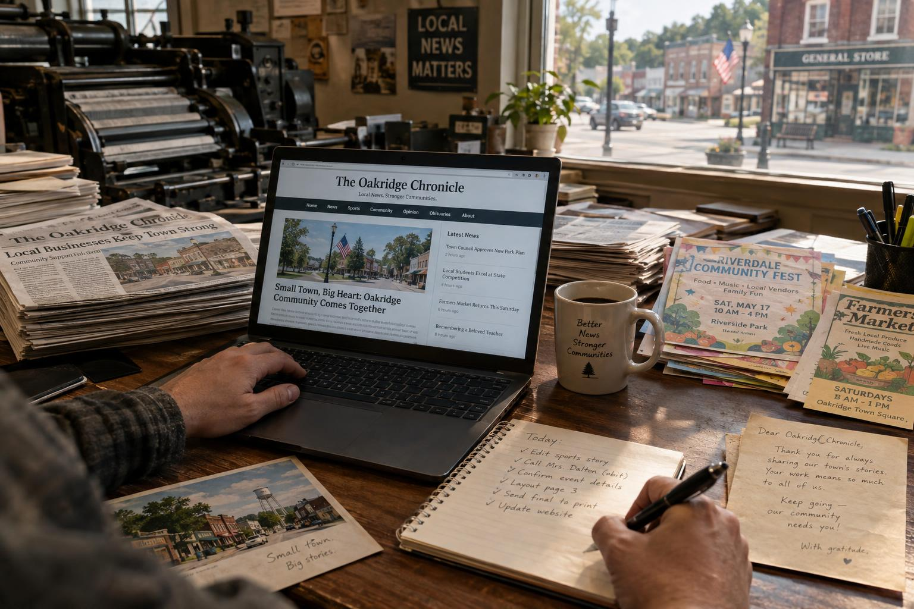

---

At dawn in Florence, Colorado, Kevin Mahmalji flipped on the ancient offset printer nestled at the back of the florescent-lit newsroom of The Florence Reporter. He was alone, as usual, surrounded by stacks of paper and humming machines. His phone buzzed beside him — a reminder that today, like every day, he’d wear multiple hats: editor, writer, photographer, advertising sales rep, delivery driver. The sun crept through dirty windows, casting long shadows over the cluttered desks, and Kevin exhaled, knowing that the stories he assembled here mattered deeply. Not just news, but lifeblood for his little town.

“I’ve been doing this for years,” Kevin said later, his voice tinged with both exhaustion and resolve. “People rely on us to keep up with what happens to their schools, their local government, their neighbors. When you’re small, there’s no other outlet for that kind of news.”

Kevin’s story isn’t unique. Across the United States, communities cling fiercely to small-town newspapers, helmed by dedicated individuals exactly like him. These are not large media conglomerates with vast editorial staffs — the papers survive because of people driven by commitment to place, a sense of responsibility to keep local stories alive. They write, edit, manage advertising, handle printing logistics, and deliver the papers door to door. Each role vital, each task done with stubborn love for the community.

---

In Schuyler, Nebraska, LuAnn Schindler’s day begins at her kitchen table, where a quiet routine helps produce the weekly newspaper she and her husband have run for a decade. “I usually write and edit all the stories myself,” she says, flanked by a family that helps with deliveries. “There’s no hiding from it: running a small newspaper is hard work. But it feels good to be the one telling the stories of our town.”

LuAnn’s hands fold carefully over stories of the local football game, council deliberations, and the annual fair. To her, these are more than articles — they’re threads in the fabric of community life. When the newspaper first came into her family’s hands, it was a lifeline for civic engagement and identity in a rapidly changing rural landscape.

Yet, financial struggles press hard. Advertising budgets have shrunk. Printing costs climb. Subscription numbers fluctuate unpredictably. “Sometimes I think about raising the rates to keep afloat,” LuAnn admits. “But it’s a balancing act. If prices go up too much, folks might stop subscribing. It’s tricky in a small town.”

Across the Midwest and New England, stories like LuAnn’s echo. The small-town newspaper is both a cultural artifact and a real-time source of accountability. For Phil Camp in Vermont, managing a family-owned newspaper and magazine network means more than business. “We’re practically the civic central I-beam for our towns,” he says. “When I think about closing, it feels like the whole community would crumble a bit.”

---

Despite digitization and the rise of social media, print newspapers remain enduringly vital to many rural and small-town communities. Older readers cherish the ritual of the paper at the breakfast table, the tangible connection to their neighborhood. Yet, distribution becomes increasingly difficult as printing presses shutter and newsprint costs soar.

In response, innovative approaches emerge. Some newspapers produce specialty guides or posters to deepen community ties while supplementing income. Collaborations between neighboring papers help share content and reduce costs. Journalistic programs partner with universities, bringing students into rural reporting initiatives that revive local coverage. Nonprofit models funded through grants and memberships grow, offering new paths to sustainability.

The people behind these efforts are entrepreneurs, public servants, and storytellers rolled into one. Their motivations often transcend profit. They see themselves as stewards guarding the truth about their towns and the vital connections that news fosters. Their labor preserves local history, fosters transparency in governance, and maintains social bonds.

---

One evening in Florence, Kevin sat at his desk, editing a story about the upcoming city council vote on a badly needed school renovation. A phone call came in — a neighbor seeking updates on a community fundraiser for flood relief. Between stories and ad copy, Kevin mused on the fragility of his vocation.

“It’s hard, no doubt,” he said with a slow smile. “But if not us, who will shine a light on what’s happening here? Who will tell the stories that only local folks know? This paper is more than news. It’s identity. It’s community.”

The rhythm of small-town newspaper life is hard and unpredictable, but its keepers are relentless. Across America, in offices small and dusty, they write the heartbeat of their towns — a commitment as ink on paper, as timeless as the communities they serve. Their stories, laboring quietly against the odds, keep the fabric of local democracy alive.

---

**Sources:**

- ColoradoSun. "While many small-town newspapers are vanishing, these Coloradans are working to keep local news alive."  
- Nebraska Public Media. "Newspaper owners strive to keep news alive in rural communities."  
- NewEngland.com. "Hard-Pressed | The Fight to Save the Small-Town Newspaper."  
- George W. Bush Presidential Center. "Keeping Rural Journalism Alive."  
- Columbia Journalism Review. "8 strategies for saving local newsrooms."  
- Local News Initiative. "The State of Local News: 2024 Report."